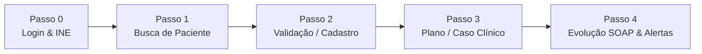

# 🦷 OdontoSmart

> **Gestão inteligente de indicadores de saúde bucal (Série B) e evolução clínica integrada à Atenção Primária à Saúde (e-SUS APS).**

O **OdontoSmart** organiza a rotina do consultório odontológico na Atenção Primária à Saúde (APS), simplifica a evolução clínica no formato SOAP e garante, de forma automatizada e em tempo real, o cumprimento das metas do Ministério da Saúde durante o atendimento na cadeira odontológica.

---

## 🎯 A Ideia

Os indicadores de saúde bucal (**Série B**) do e-SUS APS são parte central do modelo de financiamento da Atenção Primária à Saúde do Ministério da Saúde. O sistema foi desenvolvido e alinhado às diretrizes de cofinanciamento vigentes (**Nota Técnica nº 30/2025**), contemplando a divisão de produção por **INE (Identificador Nacional de Equipe)** e perfis de atuação entre o **Cirurgião-Dentista (CD)** e o **Técnico em Saúde Bucal (TSB)**.

Na correria do atendimento diário nas UBS/UPAs, equipes com frequência perdem registros cruciais — como altas odontológicas concluídas, intervenções preventivas ou ações coletivas de escovação —, gerando inconsistências cadastrais e perda de recursos financeiros.

O **OdontoSmart** resolve isso integrando o monitoramento diretamente ao atendimento: ao registrar a evolução do paciente, o sistema calcula os indicadores instantaneamente, emite alertas preventivos e informa exatamente **quantas pessoas faltam atender para que cada indicador alcance o nível Ótimo**.

---

## ✨ Principais Funcionalidades

- **Base de Dados e-SUS Local:** Importação e persistência local de cadastros e histórico populacional, garantindo buscas instantâneas (< 1s) mesmo sem internet.
- **Identificação Ágil:** Busca rápida por CPF, CNS, NIS ou Nome com cadastro inteligente (*find-or-create*) e marcadores de risco (Gestante, Diabético, Criança 6-12 anos).
- **Prontuário & Odontograma Interativo:** Mapeamento visual da dentição permanente (FDI) com status em tempo real (planejado, realizado em sessões anteriores e realizado hoje).
- **Evolução SOAP com Travas de Segurança:** Registro estruturado de Subjetivo, Objetivo, Avaliação e Plano com validação de conduta e travas de CBO (exclusividade de atos privativos do Cirurgião-Dentista).
- **Motor de Alertas Clínicos e de Metas:** Avisos no momento exato de salvar o atendimento (sugestão de alta odontológica B2, incentivo à prevenção B5 e controle de taxa de exodontia B3).
- **Ação Coletiva (PSE / B4):** Módulo dedicado para registro coletivo de escovação supervisionada em escolas e creches, sem poluir a lista de casos clínicos individuais.
- **Dashboard & Gamificação:** Pontuação estimada da equipe (0 a 1), comparativo por profissional/período e réguas de classificação (*Ótimo*, *Bom*, *Suficiente*, *Regular*).
- **Busca Ativa & Relatórios CSV:** Listas de pendências para a equipe de saúde bucal e os Agentes Comunitários de Saúde (ACS).

---

## 🔄 Rotina de Uso (Fluxo do Profissional)



1. **Passo 0 – Login e Perfil:**  
   O profissional seleciona a equipe (**INE**) e o perfil (**Cirurgião-Dentista** ou **TSB**). Toda a produção lançada é contabilizada na cota da equipe correspondente.
2. **Passo 1 – Busca Rápida:**  
   Localização imediata por CPF, CNS, NIS ou Nome na base local.
3. **Passo 2 – Validação de Perfil / Cadastro:**  
   - *Paciente não encontrado:* abertura instantânea do cadastro com marcadores de risco (gestante, diabético e identificação etária).
   - *Paciente já cadastrado:* confirmação rápida dos dados clínicos antes de iniciar o atendimento.
4. **Passo 3 – Abertura ou Continuidade do Caso Clínico:**  
   - *Paciente novo:* criação do Plano de Tratamento e registro automático da **1ª Consulta Odontológica Programada (B1)**.
   - *Paciente de retorno:* carregamento automático das pendências da última sessão e do histórico SOAP.
5. **Passo 4 – Procedimentos, SOAP e Motor de Alertas:**  
   Ao lançar os procedimentos do dia e finalizar a evolução, o motor de regras avalia o caso:
   - Se todos os dentes previstos foram tratados: *"Deseja conceder a Alta Odontológica (B2)? Faltam X pacientes para o nível Ótimo."*
   - Se for criança até 12 anos sem procedimento preventivo: *"Deseja incluir profilaxia e aplicação de flúor (B5)?"*
   - Se houver exodontia: monitoramento do teto de mutilação do indicador B3.

---

## 📊 Indicadores da Série B Contemplados

| Código | Indicador | O que mede e apuração no OdontoSmart | Parâmetro de Referência |
| :---: | :--- | :--- | :---: |
| **B1** | **1ª Consulta Odontológica Programada** | Cobertura inicial sobre a população vinculada ao INE. Registrada ao abrir o plano de tratamento (computada 1x a cada 12 meses por cidadão). | **Ótimo:** $\ge 15\%$ da população |
| **B2** | **Tratamento Concluído (Alta Odontológica)** | Resolutividade clínica: pacientes com alta sobre o total de primeiras consultas (B1). Apurado via conduta *"Tratamento concluído"*. | **Ótimo:** $\ge 75\%$ |
| **B3** | **Taxa de Exodontia** | Proporção de dentes permanentes extraídos sobre o total de procedimentos individuais. Taxas elevadas indicam modelo mutilador. | **Ótimo:** $\le 8\%$ (quanto menor, melhor) |
| **B4** | **Escovação Supervisionada (6 a 12 anos)** | Crianças dessa faixa etária que participaram de escovação supervisionada no PSE sobre o total de crianças do INE. Registrado por CD ou TSB. | **Ótimo:** $100\%$ |
| **B5** | **Procedimentos Preventivos** | Proporção de atos preventivos (flúor, selante, raspagem, cariostático, orientação) sobre o total de procedimentos. | **Ótimo:** $65\%$ a $85\%$ |
| **B6** | **Tratamento Restaurador Atraumático (ART)** | Proporção de restaurações do tipo ART sobre o total de restaurações. Ato privativo do Cirurgião-Dentista (bloqueado para TSB). | Acompanhamento contínuo |

> **Pontuação e Financiamento:** O sistema calcula a pontuação ponderada de desempenho da equipe com base nos conceitos: **Ótimo (1,00)**, **Bom (0,75)**, **Suficiente (0,50)** e **Regular (0,25)**.

---

## 🏛️ Arquitetura e Módulos do Sistema

- **Módulo de Integração e-SUS:** Leitura e importação de bases de cidadãos via arquivo CSV compatível com o padrão e-SUS APS.
- **Gestão de Pacientes e Casos Clínicos:** Cadastro com validação de duplicidade por CPF/CNS, histórico de consultas e linha do tempo de indicadores.
- **Odontograma & Atendimento SOAP:** Interface gráfica odontológica com seleção de dentes permanentes e evolução clínica estruturada.
- **Ação Coletiva (PSE):** Ferramenta dedicada para lançamento em lote de participantes em atividades coletivas de escovação.
- **Painel de Gestão (Dashboard):** Visão analítica filtrável por período (últimos 12 meses, quadrimestre atual ou ano civil) e profissional.
- **Relatórios de Busca Ativa:** Exportação em CSV de listas nominais (pacientes sem 1ª consulta, casos com alta pendente, retornos atrasados e crianças sem PSE).
- **Configurações & Governança:** Parametrização dinâmica de metas, cargas horárias da equipe (20h, 30h, 40h), cadastro de profissionais e auditoria de acessos (LGPD).

---

## 📂 Estrutura de Pastas do Projeto

O projeto é construído em arquitetura estática modular (*HTML5, CSS3 moderno e Vanilla JavaScript*), sem necessidade de instalação de dependências pesadas ou servidores complexos:

```text
odontosmart/
├── index.html                  # Ponto de entrada (redireciona para login ou dashboard)
├── README.md                   # Documentação completa do projeto
│
├── pages/                      # Telas da aplicação
│   ├── login.html              # Passo 0: Seleção de Equipe (INE) e CBO
│   ├── dashboard.html          # Painel de indicadores e pontuação da equipe
│   ├── pacientes.html          # Consulta de pacientes e linha do tempo clínica
│   ├── lembretes.html          # Central de avisos de metas e retornos de hoje/atrasados
│   ├── atendimento.html        # Atendimento, odontograma, procedimentos e SOAP
│   ├── acao-coletiva.html      # Registro rápido de ações coletivas do PSE (B4)
│   ├── relatorios.html         # Listas nominais de busca ativa e exportação CSV
│   └── configuracoes.html      # Metas da NT 30/2025, usuários, logs e importação e-SUS
│
├── css/                        # Estilos da interface
│   ├── base.css                # Reset, tipografia e grid estrutural (sidebar, header)
│   ├── components.css          # Cards de indicadores, tabelas, modais, badges e botões
│   └── atendimento.css         # Estilos específicos do odontograma e evolução SOAP
│
└── js/                         # Lógica da aplicação desacoplada por camada
    ├── core/                   # Camada de dados e infraestrutura
    │   ├── util.js             # Formatação de datas, CPF, CSV e componentes modais
    │   ├── seed.js             # Gerador determinístico de dados de demonstração
    │   └── store.js            # Repositório de dados local (localStorage) e regras de gravação
    ├── services/               # Motores de regras de negócio
    │   ├── indicadores.js      # Motor matemático de cálculo dos indicadores B1-B6
    │   └── alertas.js          # Motor de alertas clínicos e bloqueios de CBO
    ├── ui/                     # Interface compartilhada
    │   ├── layout.js           # Renderização de cabeçalho, menu lateral, rodapé e sessão
    │   └── componentes.js      # Renderizador do odontograma FDI e cards de métricas
    └── pages/                  # Controladores e eventos específicos de cada tela
        ├── login.js
        ├── dashboard.js
        ├── pacientes.js
        ├── lembretes.js
        ├── atendimento.js
        ├── acao-coletiva.js
        ├── relatorios.js
        └── configuracoes.js
```

---

## 🗄️ Entidades de Dados Principais

```text
┌─────────────────┐       ┌─────────────────┐       ┌─────────────────┐
│    Paciente     │◄──────│   Caso Clínico  │◄──────│   Atendimento   │
│ (CPF, CNS, INE) │       │ (Plano e Status)│       │  (SOAP, Procs)  │
└─────────────────┘       └─────────────────┘       └─────────────────┘
         ▲                                                   │
         │                                                   ▼
┌─────────────────┐                                 ┌─────────────────┐
│ Ativ. Coletiva  │                                 │  Procedimento   │
│  (PSE / B4)     │                                 │ (SIGTAP, Categ) │
└─────────────────┘                                 └─────────────────┘
```

- **Paciente:** Identificação civil, CNS, NIS, contatos, dados familiares, equipe INE vinculada e marcadores de risco.
- **Profissional:** Nome, perfil CBO (Dentista ou TSB), registro profissional no conselho, equipe e carga horária contratual.
- **Caso Clínico & Plano de Tratamento:** Registro central de acompanhamento de cada cidadão, associando os dentes e procedimentos planejados.
- **Atendimento (Evolução SOAP):** Registro cronológico da sessão, profissional executante, conduta clínica e procedimentos realizados.
- **Atividade Coletiva:** Data, local da ação (escola, creche), tipo de intervenção e participantes vinculados.

---

## 🛡️ Segurança, Desempenho e LGPD

- **Execução Offline & Alta Disponibilidade:** Busca e persistência local garantem resposta em menos de 1 segundo mesmo durante oscilações de rede nas unidades de saúde.
- **Segurança de Acesso e Perfis (CBO):** Travas automatizadas impedem que profissionais lancem procedimentos incompatíveis com sua habilitação legal.
- **Trilha de Auditoria:** Histórico detalhado de alterações administrativas e registros de consulta a dados sensíveis de pacientes para conformidade com a LGPD.

---

## 🗺️ Roteiro de Desenvolvimento (Roadmap)

| Fase | Marco | Entregas |
| :---: | :--- | :--- |
| **Fase 1** | **Levantamento & Regras** | Validação das metas com profissionais da APS e consolidação das normas da Nota Técnica nº 30/2025. |
| **Fase 2** | **Prototipação** | Estruturação das interfaces de busca, cadastro, odontograma interativo e evolução SOAP. |
| **Fase 3** | **MVP Funcional** | Motores de cálculo de B1 a B6, banco local determinístico e alertas em tempo real integrados à consulta. *(Versão Atual)* |
| **Fase 4** | **Painéis & Busca Ativa** | Geração de relatórios operacionais em CSV, exportação de pendências para os ACS e refinamento de filtros. |
| **Fase 5** | **Evolução & Interoperabilidade** | Exportação de dados formatados para integração direta com as fichas CDS/Thrift do e-SUS APS e SISAB. |

---

## 🚀 Como Executar

Por ser um projeto web moderno baseado em padrões abertos, não requer Node.js, compilação ou banco de dados externo:

1. Clone ou baixe este repositório:
   ```bash
   git clone https://github.com/saulo13tomazz/Projeto-OdontoSmart.git
   ```
2. Abra o arquivo `index.html` diretamente em qualquer navegador moderno (Chrome, Edge, Firefox, Safari).
3. Selecione a equipe e o perfil desejado na tela inicial para começar a explorar o sistema.
